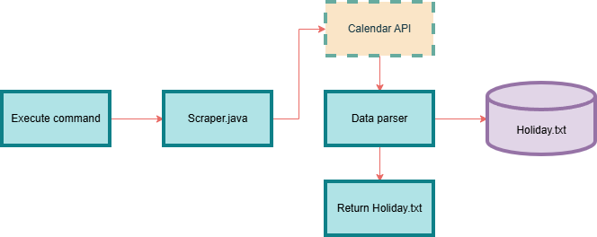

# Days-Off Calendar

Grabs dates from the Purdue academic calendar to list when long weekends and holidays take place.

## The Problem

My mother mentioned she has a hard time figuring out when I and my siblings' holiday schedules align, so I want to build an mvp to provide her with a clean list of all the potential dates I can come home to visit

## How It Works

Run a command to execute the program, which leads the scraper to grab data from the calendar API. The next class will read the data from the API, write it to the terminal or (eventually) a .txt file listing the days off in order and the duration of the break. Once finished it will return the .txt file.

## Tech Stack

- **Language:** Java
- **Libraries:** Jackson
- **External tools:** Purdue yearly calendar API

## Setup

WORK IN PROGRESS

## Usage

WORK IN PROGRESS

## Roadmap

- [ ] Write to organized text file
- [ ] Multi-calendar reading

## Author

Epsilon Spychalski (Github: [Epsilonw0w](https://github.com/Epsilonw0w))
